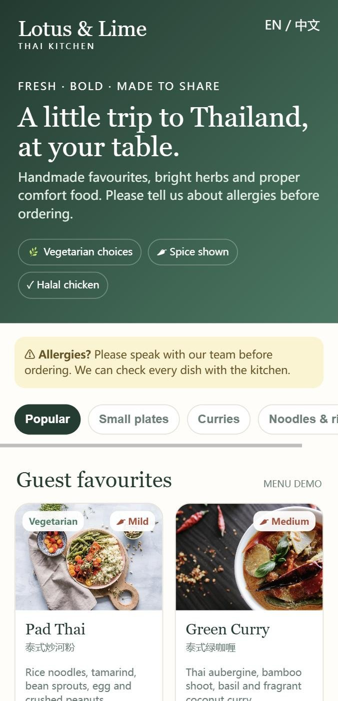
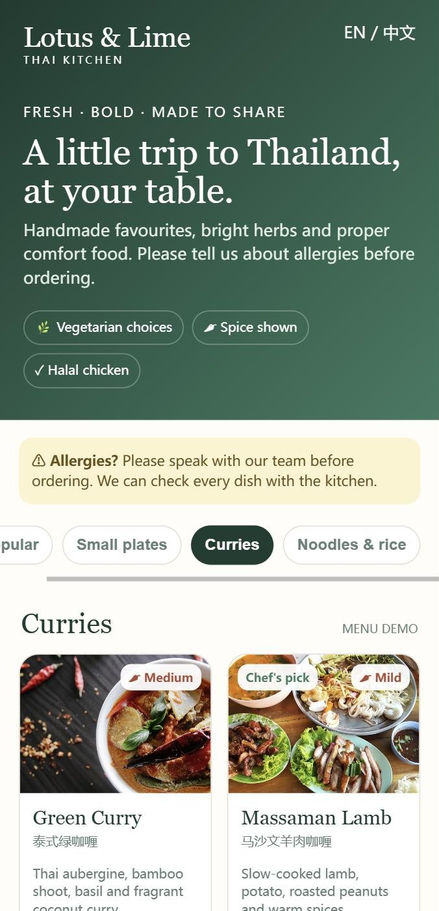
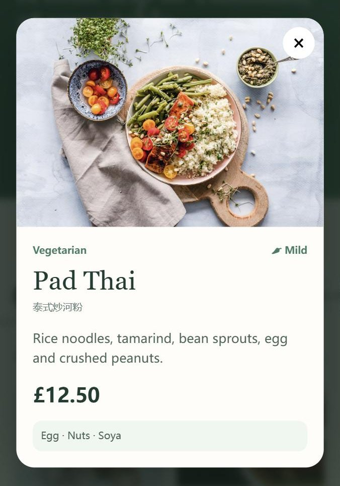

# Digital Menu Demo

A mobile-first digital menu for independent restaurants, built as a small prototype to test whether a single, photo-led menu page is easier for guests to use than separate PDF menus. In use, guests scan a QR code on the table to open the menu on their phone.

**Live demo:** https://lotus-lime-menu-demo.sappyperch4.chatgpt.site/

> The demo is a fictional Thai restaurant ("Lotus & Lime"). All dishes, prices and descriptions are sample data.

<p align="center">
  
  
  
</p>

**Scan to try it on your phone:**


## What it does

- Category filtering (Popular, Small plates, Curries, Noodles & rice)
- Dish cards with photo, price, spice level, dietary tags and allergen summary
- Tap a dish to open a detail view
- Dish names shown in English and Chinese
- Layout designed for phones first, readable on larger screens

## How it is built

- Plain HTML, CSS and JavaScript (ES modules); no framework and no build step required
- All menu content lives in one data file (`src/menu-data.js`), so a different restaurant's menu can be swapped in without touching the interface code
- The visual theme is a default style, not a fixed brand; it can be restyled per restaurant

## Project context

I built this as part of an early-stage business exploration. Alongside the prototype I researched independent UK restaurants whose public menus are PDFs or several separate documents, wrote personalised outreach, and tracked delivery and replies. The outreach is ongoing and has not yet produced a customer, so this repository contains only the prototype, not any restaurant data.

## Run locally

Serve the folder with any static server, for example:

```
npx serve .
```

Then open the printed address on your computer or phone.

## Credits

Dish photos are hotlinked from [Unsplash](https://unsplash.com) and are used for demonstration only.
